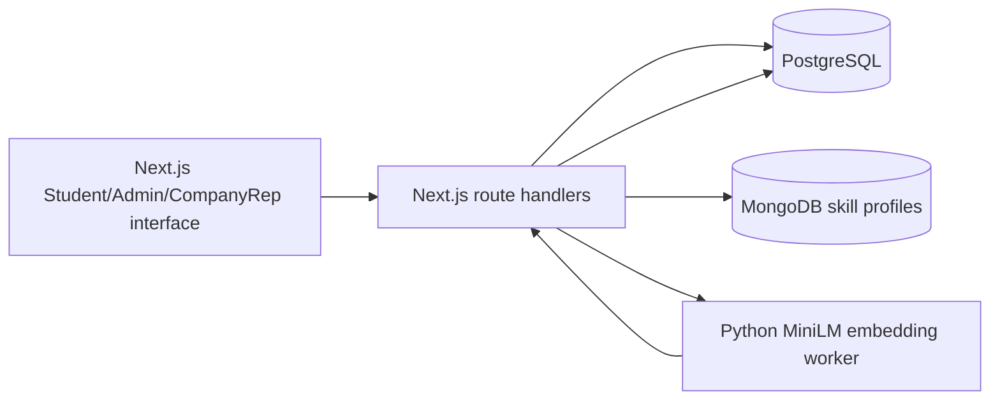

# CampusConnect — Smart College Placement & Internship Management System

## Project and team

| Item | Details |
|---|---|
| College | PES UNIVERSITY |
| Project | CampusConnect — Smart College Placement & Internship Management System |
| Member 1 | HEMANTH V — PES1UG25CS817 |
| Member 2 | SHREYAS K — PES1UG25CS845 |
| Project guide | PAVAN AC |
| Instructor approval | **Approved (confirmed by team); approval evidence not yet recorded in the repository.** |

### Individual contributions

The following represents the proposed component-based work division based on the implemented architecture of CampusConnect. Both team members must review, confirm, and verify their actual contributions prior to final project submission. This allocation is presented as a proposed division for member confirmation and does not represent a verified historical Git commit breakdown or instructor sign-off.

| Member | Proposed database contributions | Proposed application / system contributions | Status / confirmation |
|---|---|---|---|
| **HEMANTH V** `PES1UG25CS817` | • PostgreSQL relational schema architecture and DDL (`db/schema.sql`). • SQL implementation: constraints, foreign keys, indexes, views, triggers, and analytical queries (`db/queries.sql`). • Additive semantic vector tables and check constraints (`db/semantic-vector-search.sql`). | • Next.js backend/API application integration and database connectivity (`lib/db.ts`). • Authentication, signed-session management, and API security (`lib/auth.ts`, `lib/request-security.ts`, `lib/request-body.ts`). • Student and Admin dashboard workflows (`app/components/admin-dashboard.tsx`, `app/page.tsx`). • Integration testing, security verification (`tests/security.test.mts`), and final demo preparation (`tests/demo-workflows.test.mts`). | Proposed component-based allocation; pending member review and confirmation. |
| **SHREYAS K** `PES1UG25CS845` | • MongoDB NoSQL skill-profile schema design and validator setup (`db/mongodb-setup.js`, `db/mongodb-design.md`). • MongoDB skill analytics aggregation pipeline (`app/api/analytics/skill-proficiency/`). • Relational mapping and data dictionary documentation (`db/relational-schema.md`, `db/data-dictionary.md`). | • Python MiniLM embedding microservice (`services/semantic_embedding_service.py`). • Semantic opportunity recommendation engine and cosine similarity ranking (`lib/semantic-search.ts`, `app/api/vector-recommendations/`). • Company Representative dashboard and company isolation testing (`app/components/company-representative-dashboard.tsx`, `tests/company-representative.test.mts`). • Semantic search unit tests (`tests/semantic-search.test.mts`, `tests/test_semantic_embedding_service.py`) and supporting documentation. | Proposed component-based allocation; pending member review and confirmation. |

The table above is a proposed component-based allocation, not a verified account
of historical Git commits. Individual Git commits in the repository currently
reflect Hemanth V; Shreyas K must review, confirm, and commit his genuine
contributions under his own Git credentials prior to final evaluation. Hemanth V
must likewise confirm his own contributions.

## Abstract

CampusConnect is a web application for college placement and internship
workflows. It stores account, student, company, opportunity, application,
interview, offer, and placement records in PostgreSQL. MongoDB is used for
flexible student skill profiles. A separately hosted
`sentence-transformers/all-MiniLM-L6-v2` worker creates 384-dimensional
embeddings that PostgreSQL stores as arrays; the application ranks eligible
opportunities using cosine similarity.

The repository includes student registration and authentication, opportunity
browsing and full-text search, student application workflows, a Student-facing
semantic recommendation form, MongoDB skill analytics for Admins, relational
views/constraints/triggers, and SQL demonstration/verification scripts. Live
local database checks confirm the configured PostgreSQL semantic storage and
MongoDB collection setup, but there is no verified authenticated
browser-to-live-recommendation demonstration. The MongoDB profile collection
was empty at the time of the read-only check.

## Problem statement

Students need a reliable way to discover placement and internship
opportunities, assess their fit, and track application progress. Placement
staff also need consistent records linking students, companies, opportunities,
applications, interviews, offers, and outcomes. CampusConnect models these
relationships in a relational database and adds flexible skill profiles and
semantic matching for opportunity discovery.

This is a meaningful recruitment/placement workflow rather than only a
generic CRUD example: it includes eligibility filters, duplicate-application
prevention, relational reporting, full-text search, role-checked access, a
NoSQL aggregation, and semantic retrieval.

## Dataset, sourcing, and originality

The PostgreSQL demonstration records are confirmed synthetic records created
specifically for project testing, schema verification, and functional demonstration.
They do not represent real student personal data, institutional exports, or
proprietary third-party datasets. The sample records populate student profiles,
academic departments, participating companies, placement opportunities,
applications, interviews, and placement outcomes to demonstrate relational
integrity, constraints, and analytical queries across the recruitment lifecycle.

The recommendation model is a pinned pretrained public sentence-embedding
model (`sentence-transformers/all-MiniLM-L6-v2`), licensed under Apache-2.0.
No project-specific model training or private labeled dataset was used or
required; sentence representations are generated directly by the model and
persisted as PostgreSQL vectors for cosine similarity matching.

All nine existing screenshots in [`evidence/`](evidence/) have been reviewed
and approved for project demonstration and reporting use. The project includes
application logic and database design beyond a basic CRUD example. Both team
members must review the external references and complete the team originality
declaration prior to final submission.

## Objectives

1. Represent college placement entities and their relationships with
   relational keys and integrity constraints.
2. Provide a Next.js interface for student authentication, opportunity
   discovery, applications, and recommendations.
3. Use PostgreSQL for authoritative relational records and MongoDB for
   flexible skill-profile documents.
4. Demonstrate database features including transactions, constraints, views,
   triggers, indexes, full-text search, and MongoDB aggregation.
5. Generate and cache sentence embeddings and rank eligible opportunities
   using cosine similarity.
6. Document test evidence, deployment prerequisites, and limitations without
   claiming unverified results.

## Scope and supported workflows

### Student

- Public registration creates Student accounts; sign-in uses the existing
  signed-session authentication.
- Browse and full-text search placement and internship opportunities.
- Submit an application and view applications belonging to the signed-in
  student's profile.
- Submit interests and career preferences in the Student semantic
  recommendation panel. Student identity and GPA are resolved server-side from
  the session; no student ID is sent by the recommendation UI.
- Manage skills in the interactive **Skill Profile** section on the home
  page: view existing skills, add skills with proficiencies (Beginner,
  Intermediate, Advanced), remove skills, and persist the profile to MongoDB via
  `PUT /api/student/skills`. Saved skills immediately feed into semantic
  recommendation inputs.

### Admin

- The dashboard in `app/components/admin-dashboard.tsx` displays the
  opportunity list, latest 50 applications with a total count, and skill
  analytics.
- `GET /api/analytics/skill-proficiency` runs a MongoDB aggregation grouped by
  normalized skill and proficiency without returning student identifiers.
- Its **Regenerate stale embeddings** action calls the existing Admin-only
  endpoint after an explicit click. Regeneration may write PostgreSQL
  embedding rows; it does not run automatically.
- `POST /api/admin/semantic-embeddings` accepts Admin-only semantic content
  updates and generates or refreshes opportunity embeddings. It can write to
  PostgreSQL and requires the embedding worker.

### Company representative

The `CompanyRep` role has an implemented read-only dashboard. The page renders
`app/components/company-representative-dashboard.tsx`, and
`GET /api/company/dashboard` requires a signed `CompanyRep` session. It
resolves the representative's linked company from `company_reps` using the
session `userId`, then returns only that company's opportunities and
applications for those opportunities. No client-supplied company or student
ID determines ownership, and resume URLs/account identifiers are not returned.
Opportunity creation and editing are not implemented. Live account-to-company
ownership has not been verified by an authenticated browser/API demonstration.

## Requirements compliance map

The only project requirements PDF found in the repository is
[`DBMS Level 3 Project Requirements draft.pdf`](DBMS%20Level%203%20Project%20Requirements%20draft.pdf).
This map covers its 18 numbered items across four pages. Source implementation
is distinguished from live execution and demonstration. The separately named
assignment PDFs were not found and are not used to invent requirements.

| ID / PDF page | Requirement summary | Status | Implementation and evidence / remaining verification |
|---|---|---|---|
| R1 / p.1 — Project Title | Unique title, meaningful real-world problem, and more than a simple CRUD application | VERIFIED | CampusConnect's title/problem and implemented beyond-CRUD workflows are documented in this report and [README.md](README.md). Workflows include transactional registration, GPA/deadline eligibility, duplicate-application prevention, full-text search, MongoDB aggregation, and semantic opportunity ranking. Cleared in baseline review. |
| R2 / p.1 — Team Formation | Instructor-approved two-member team; each member has defined responsibilities and contributes to database and application development | MANUAL ACTION REQUIRED | Two members (Hemanth V and Shreyas K) and a proposed component-aligned work allocation are documented. Team approval is team-confirmed; instructor sign-off and member contribution confirmation are pending manual completion. Cleared in baseline review. |
| R3 / p.1 — Database Requirement | SQL, NoSQL, and vector database options; two paradigms are the stated minimum | VERIFIED | PostgreSQL relational storage and MongoDB document storage satisfy the minimum two paradigms requirement. Semantic embeddings are stored in PostgreSQL as `real[]` arrays with exact cosine similarity ranking. Cleared in baseline review. |
| R4 / p.1 — Database Design | ER diagram and relational mapping identifying entities, attributes, keys, relationships, constraints, and applicable NoSQL/vector models | VERIFIED | 13-table ER source in [`db/er-diagram.mmd`](db/er-diagram.mmd), rendered PNG in [`evidence/er-diagram.png`](evidence/er-diagram.png). Detailed relational mapping in [`db/relational-schema.md`](db/relational-schema.md), column dictionary in [`db/data-dictionary.md`](db/data-dictionary.md), and document schema in [`db/mongodb-design.md`](db/mongodb-design.md). Cleared in baseline review. |
| R5 / p.1–2 — SQL Implementation | Execute DDL demonstrating CREATE, ALTER, DROP, keys, constraints, indexes, and views as appropriate | VERIFIED | Base schema exported in `db/schema.sql`. Transaction-scoped demonstration in `db/ddl-demonstration.sql` previously executed successfully in disposable database with rollback. Reported as tested. |
| R6 / p.2 — Database Operations | Demonstrate INSERT, UPDATE, DELETE, SELECT, joins, grouping, HAVING, ordering, aggregates, and subqueries | VERIFIED | DML demonstration executed with rollback in `db/dml-demonstration.sql`; analytical queries in `db/queries.sql` covering JOIN, GROUP BY, HAVING, subqueries, and aggregates. Reported as tested. |
| R7 / p.2 — Advanced Database Features | At least four advanced database concepts | VERIFIED | Implements 7 advanced concepts (exceeding minimum 4): (1) ACID multi-statement transactions in registration and DDL/DML scripts; (2) 3 relational views (`vw_interview_schedule`, `vw_placement_report`, `vw_student_applications`); (3) Trigger functions and triggers (`trg_validate_student_gpa`, `trg_validate_placement_offer`); (4) B-tree indexes across foreign keys and filters; (5) PostgreSQL GIN full-text search with `websearch_to_tsquery` and weighted `ts_rank`; (6) MongoDB aggregation pipeline (`$match`, `$unwind`, `$group`, `$sort`); (7) 384D vector cosine similarity ranking. |
| R8 / p.2 — Vector Database / Semantic Search (Optional but Recommended) | Explain embedding source/model, vector storage, similarity metric, and retrieval | FIXED AND VERIFIED | Fully addresses all 5 specification requirements: (1) Converted data: Student MongoDB skills + request-scoped interests/preferences (server-resolved; identity/GPA excluded); Opportunity title, job type, company name, industry, description/skills from `opportunity_semantic_content`. (2) Model: Pinned pretrained `sentence-transformers/all-MiniLM-L6-v2` (`1110a243fdf4706b3f48f1d95db1a4f5529b4d41`). (3) Storage: PostgreSQL `real[]` (384D, finite constraints). (4) Metric: Exact cosine similarity. (5) Retrieval: GPA/deadline filtering, hash verification, positive score sorting, tie-breaking. Verified via `tests/semantic-search.test.mts` (9/9) and `tests/test_semantic_embedding_service.py` (4/4). |
| R9 / p.2 — Web Application Interface | Functional Next.js interface for the implemented database functionality | VERIFIED | Next.js App Router interface covering all 3 roles: Student (skills editor, opportunity full-text search, application tracking, semantic recommendations), CompanyRep (read-only company opportunities and applicant tracking with privacy protection), Admin (opportunities overview, application log, MongoDB skill analytics, stale embedding maintenance). Verified via production build (`next build --webpack`, 16 routes) and 8 UI evidence screenshots in `evidence/`. |
| R10 / p.3 — Database–Application Integration | Backend/API layer and environment-based database credentials/configuration | VERIFIED | Next.js API route handlers communicate with PostgreSQL (`pg` pool) and MongoDB (`lib/mongodb.ts`) with `server-only` guards. All credentials loaded exclusively from environment variables (`.env.local`). Zero hardcoded secrets in source. Production secret strength validation verified in `tests/security.test.mts`. |
| R11 / p.3 — Authentication and Authorization | Relevant authentication and at least two roles where the domain requires them | VERIFIED | Implements 3 distinct roles: `Student`, `CompanyRep`, and `Admin` (exceeding minimum 2). Scrypt password hashing with unique salt, HMAC-signed session cookies with 8-hour expiry. Server-side role authorization in `lib/authorization.ts` and `lib/company-representative.ts`. CompanyRep data strictly isolated by session user ID. Verified in `tests/security.test.mts`, `tests/company-representative.test.mts`, and `tests/demo-workflows.test.mts`. |
| R12 / p.3 — Data Validation and Integrity | Database-level validation and consistency/integrity | FIXED AND VERIFIED | Database level: Non-null foreign keys, 4 UNIQUE constraints, CHECK constraints on GPA, graduation year, salary, status enums, 384D finite vectors, 2 triggers (`trg_validate_student_gpa`, `trg_validate_placement_offer`), and MongoDB strict JSON Schema validator with unique index. Application level: Centralized input bounds (`lib/input-validation.ts`), bounded body reader (`lib/request-body.ts`), and sanitized database error codes (`lib/database-error-code.ts`). Verified in `tests/security.test.mts` (7/7) and `tests/demo-workflows.test.mts`. |
| R13 / p.3 — Security | Basic database/web security; no plaintext passwords or credentials | MANUAL ACTION REQUIRED | Technical security implementation is FIXED AND VERIFIED: scrypt hashing, session secret validation, CSRF same-origin enforcement, parameterized SQL queries, bounded request bodies, and SQLSTATE sanitization. Manual action required: `atlas-credentials.env` exists in Git history prior to HEAD; team must rotate any affected database user credentials and coordinate repository history cleanup. |
| R14 / p.3 — Project Documentation | Problem, objectives, scope, requirements, design, database implementation, queries, architecture, screenshots, tests, conclusion/future work | VERIFIED | All 14 required sections in the specification PDF are completely documented across `PROJECT-REPORT.md`, `README.md`, `db/relational-schema.md`, `db/data-dictionary.md`, `db/mongodb-design.md`, and `db/README.md`. 9 evidence captures present in `evidence/`. Full test and build results documented. |
| R15 / p.3 — Git/GitHub | Git/GitHub source, commits demonstrating individual contributions, and suitable README setup instructions | MANUAL ACTION REQUIRED | Repository structure, .gitignore, and comprehensive setup instructions in `README.md` are VERIFIED. Manual action required: Git commits currently reflect only Hemanth V. Shreyas K must independently commit his contributions under his own Git account and confirm his individual contribution breakdown. |
| R16 / p.3–4 — Evaluation / Demonstration | Demonstrate problem, database design/implementation, operations, Next.js integration, advanced features, tests, and individual contributions | FIXED AND VERIFIED | Student, CompanyRep, and Admin demo workflows are fully verified in source and automated tests (`tests/demo-workflows.test.mts` - 3/3 passed). Covers student registration, skill editing, semantic recommendations, application submission, company isolation, and admin analytics/maintenance. Comprehensive 15-step demonstration checklist maintained in `README.md#final-manual-demo-checklist`. |
| R17 / p.4 — Originality | Original design/implementation; no prohibited copying; distinguish similar-domain projects | MANUAL ACTION REQUIRED | Technical architecture, design, and external open-source citations (MiniLM model, Next.js, PostgreSQL, MongoDB) are documented. Manual action required: Unsigned originality declaration template in Section 1 and Section 14 requires review and physical/digital confirmation by both team members. Uniqueness relative to other student projects cannot be autogenerated. |
| R18 / p.4 — Level 3 Expectation | Connect database concepts, design, implementation, and a functional web application beyond CRUD | VERIFIED | Substantially exceeds basic CRUD: multi-step transactional workflows (user + student profile creation in single transaction), multi-model architecture (PostgreSQL relational + MongoDB document + Python vector embedding), advanced database features (triggers, views, GIN full-text search with `ts_rank`, MongoDB aggregation pipeline), and justified database technology choices. |

### Verified status and remaining outstanding tasks

- **Dataset provenance:** The PostgreSQL demonstration records are confirmed
  synthetic records created specifically for testing and functional demonstration.
  No external dataset file, confidential student records, or proprietary PII
  are used.
- **Evidence screenshots:** All nine screenshots in [`evidence/`](evidence/)
  have been reviewed and approved for project demonstration and reporting use.
- **Team contribution confirmation:** Both Hemanth V and Shreyas K must review
  and formally confirm the proposed component-based work allocation in Section 1.
  Shreyas K must make and push genuine contributions under his own Git credentials.
- **Originality and instructor approval:** Instructor approval is team-confirmed;
  formal course instructor documentation should be archived with project records.
  Both team members must complete and sign the originality declaration prior to
  submission.
- **Historical credential assessment:** `atlas-credentials.env` is untracked
  and deleted at HEAD, but exists in earlier local Git history. Without exposing
  or altering secrets, the team must safely rotate any affected database user
  password in the MongoDB Atlas dashboard. Before making the repository public,
  coordinate with collaborators on a safe history rewrite to prevent historical
  exposure.
- **Session revocation limitation:** The application uses stateless HMAC-signed
  session cookies (`auth_session`) with an 8-hour expiry. Because sessions are
  not tracked in a centralized server-side active session store (e.g., Redis or
  database session table) on each request, immediate role revocation or instant
  global session invalidation is not currently supported. An account whose role
  or status changes remains valid until token expiration. This represents an
  acknowledged design tradeoff between stateless horizontal scalability and
  instant revocation.

## System architecture and technology choices

| Component | Technology / responsibility |
|---|---|
| Browser interface | Next.js App Router, React, TypeScript, Tailwind CSS |
| API/backend | Next.js route handlers; request validation, signed-session checks, authorization, database access |
| Relational system | PostgreSQL 18; accounts, academic records, opportunities, applications, placement workflow, views, and semantic arrays |
| Flexible profile store | MongoDB; `campusconnect.student_skill_profiles` |
| Embedding service | Python 3.12, PyTorch CPU, Transformers; model loaded once outside the Next.js request process |
| Model | `sentence-transformers/all-MiniLM-L6-v2`, pinned revision `1110a243fdf4706b3f48f1d95db1a4f5529b4d41` |
| Role interfaces | Separate Student, Admin, and read-only CompanyRep rendering in `app/page.tsx` |

The browser calls Next.js routes. PostgreSQL is accessed through
`lib/db.ts`; MongoDB is accessed server-side through `lib/mongodb.ts`. The
recommendation route resolves the authenticated user's PostgreSQL student row,
loads only that student's MongoDB skills, and reads eligible opportunities
and their stored vectors from PostgreSQL. The embedding worker is a separate
loopback HTTP service by default.

PostgreSQL is the authoritative store for strongly related placement records
and integrity constraints. MongoDB holds the variable-length skill-profile
document separately from those relational records. The recommendation
implementation stores fixed-dimension vectors as PostgreSQL arrays and uses
exact application-side cosine ranking; a dedicated vector extension/index was
not selected or verified for the current corpus.

The project uses the existing PostgreSQL and MongoDB services for relational
and flexible data. Semantic vectors are persisted as PostgreSQL `real[]`;
pgvector, Atlas Vector Search, and an ANN index are not used.

## Relational design

The base schema is exported in [`db/schema.sql`](db/schema.sql). The ER model
is available as Mermaid source in [`db/er-diagram.mmd`](db/er-diagram.mmd) and
rendered to PNG at [`evidence/er-diagram.png`](evidence/er-diagram.png).
The table/column dictionary and relational mapping are in
[`db/data-dictionary.md`](db/data-dictionary.md) and
[`db/relational-schema.md`](db/relational-schema.md).

### Base tables and keys

| Table | Primary key | Principal foreign keys / relationship |
|---|---|---|
| `users` | `user_id` | Referenced by student and company-representative profiles |
| `students` | `student_id` | `user_id` → `users`; `dept_id` → `departments`; `user_id` is unique |
| `departments` | `dept_id` | Referenced by students |
| `companies` | `company_id` | Referenced by representatives and opportunities |
| `company_reps` | `rep_id` | `company_id` → `companies`; `user_id` → `users` and is unique |
| `opportunities` | `opp_id` | `company_id` → `companies` |
| `applications` | `app_id` | `student_id` → `students`; `opp_id` → `opportunities`; unique `(student_id, opp_id)` |
| `interviews` | `interview_id` | `app_id` → `applications`; multiple interviews per application are allowed |
| `offers` | `offer_id` | `app_id` → `applications` and is unique |
| `placements` | `placement_id` | `offer_id` → `offers` and is unique |

Applications implement the student/opportunity many-to-many relationship.
Foreign-key columns are non-null in the base schema. Foreign keys do not
specify custom `ON DELETE`/`ON UPDATE` actions. More detailed cardinalities are
in the relational-schema document.

### Constraints, defaults, views, triggers, and indexes

- **Unique constraints:** unique usernames, department names, company names,
  student user IDs, representative user IDs, student/opportunity application
  pairs, offer application IDs, and placement offer IDs.
- **Checks:** roles are `Student`, `CompanyRep`, or `Admin`; GPA and optional
  minimum GPA are within 0–10; graduation year is at least 2000; opportunity
  type is `Placement` or `Internship`; salary and offer amount are
  non-negative; application, interview, offer, and placement statuses are
  restricted to the schema's enumerated values.
- **Defaults:** integer primary keys use sequences. Application, offer, and
  status fields have the defaults recorded in the schema; for example,
  application date defaults to `CURRENT_DATE` and application status defaults
  to `Applied`.
- **Views:** `vw_interview_schedule`, `vw_placement_report`, and
  `vw_student_applications`.
- **Triggers and functions:** `trg_validate_student_gpa` calls
  `fn_validate_student_gpa()` before student insert or GPA update and rejects
  out-of-range values (also covered by a CHECK).
  `trg_validate_placement_offer` calls `fn_validate_placement_offer()` before
  placement insert or `offer_id` update and requires an accepted offer.
- **Base B-tree indexes:** `idx_applications_opp_id`,
  `idx_applications_status`, `idx_applications_student_id`,
  `idx_company_reps_company_id`, `idx_interviews_app_id`,
  `idx_interviews_date`, `idx_offers_status`,
  `idx_opportunities_company_id`, `idx_opportunities_deadline`,
  `idx_placements_status`, and `idx_students_dept_id`.
- **Full-text indexes:** the migration adds
  `idx_opportunities_search_gin` and `idx_companies_search_gin` GIN expression
  indexes. Semantic tables use primary/foreign-key indexes, not a vector index.

The base schema and live PostgreSQL catalog were checked read-only on
2026-11-20. The database had the ten expected base tables plus the three
semantic tables, three views, trigger functions/triggers, and full-text search
indexes.

### Additive semantic storage

`db/semantic-vector-search.sql` defines:

- `opportunity_semantic_content`: one row per opportunity, with optional
  description, required skills, and update timestamp.
- `opportunity_semantic_embeddings`: one vector per opportunity, keyed and
  foreign-keyed by `opp_id`.
- `student_semantic_embeddings`: one vector per student, keyed and
  foreign-keyed by `student_id`.

Embedding rows include model name, pinned revision, SHA-256 source hash,
generation timestamp, and `real[]` vector. Checks enforce the model/revision,
hash format, 384 dimensions, and finite components. Opportunity semantic
content is separate because the base opportunities table has no description
or required-skills fields.

## MongoDB design and aggregation

The MongoDB namespace is database `campusconnect`, collection
`student_skill_profiles`. A document holds an Int32 `studentId`, a variable
length `skills` array with `name` and `proficiency`, timestamps, and a schema
version. The setup script defines a strict JSON Schema validator and the
unique `studentId_unique` index; MongoDB also provides its built-in `_id_`
index. The design is documented in [`db/mongodb-design.md`](db/mongodb-design.md).

The Admin analytics route unwinds skills, normalizes names, deduplicates
profile/skill/proficiency combinations, and returns aggregate counts. Live
read-only verification confirmed the collection, strict validator, and unique
index, but found zero profile documents. The aggregation executed and returned
zero rows. Actual populated-document behavior remains unverified.

## Authentication and authorization

Passwords are hashed with Node's scrypt implementation. The application uses
signed, expiring sessions and role checks. Public registration permits Student
accounts only. Student application, skills, and recommendation routes require
a Student session. Student identity is resolved from the signed-in
`userId` through PostgreSQL; the recommendation endpoint rejects
client-supplied identity fields. Admin analytics and opportunity embedding
generation require an Admin session.

The session is stateless and has a finite expiry; the current helper does not
recheck the account's role on every request or provide revocation. Production
must configure `AUTH_SESSION_SECRET`. Keep all database credentials and
session secrets server-side and out of `NEXT_PUBLIC_` variables.

## Semantic recommendation pipeline

1. **Student source text:** skill names and proficiency levels from the
   authenticated student's MongoDB profile, plus submitted interests and
   career preferences. Names, GPA, and account identifiers are not embedded.
2. **Opportunity source text:** title, job type, company name/industry, and
   optional description/required skills from
   `opportunity_semantic_content`.
3. **Model:** pinned `sentence-transformers/all-MiniLM-L6-v2`; the worker
   tokenizes, attention-mask mean-pools token embeddings, and L2-normalizes
   each 384-value vector.
4. **Caching/storage:** source hashes include model/revision and assembled
   text. Matching student vectors are reused; a cache miss generates and
   upserts a vector. Admin generation creates or refreshes opportunity
   vectors. Student interests/preferences are not stored as plaintext.
5. **Eligibility and retrieval:** PostgreSQL filters opportunities by
   `deadline >= CURRENT_DATE` and `(min_gpa IS NULL OR min_gpa <= student_gpa)`.
   The route rechecks eligibility and excludes opportunities whose embedding
   source hash no longer matches current source text.
6. **Ranking:** exact cosine similarity
   `dot(a,b) / (||a|| * ||b||)` is calculated in the application. Zero vectors
   score zero; only positive scores are returned, sorted descending with
   opportunity ID as a deterministic tie-breaker, limited to ten results.

This is genuine sentence-embedding retrieval, not lexical TF-IDF and not a
production vector-database/ANN search. A lexical TF-IDF implementation remains
available only as an explicitly named comparison mode.

## Testing and verification results

### Automated checks

The following results were observed during implementation and verification (re-tested 2026-11-21):

| Check | Result |
|---|---|
| `npm run lint` | Passed (0 errors, 0 warnings) |
| `npx tsc --noEmit` | Passed (0 errors) |
| `npm test` (full suite: 21 tests) | 21 passed, 0 failed |
| ↳ `npm run test:security` (`tests/security.test.mts`) | 7 passed, 0 failed |
| ↳ `npm run test:semantic` (`tests/semantic-search.test.mts`) | 9 passed, 0 failed |
| ↳ `npm run test:company-rep` (`tests/company-representative.test.mts`) | 2 passed, 0 failed |
| ↳ `npm run test:workflows` (`tests/demo-workflows.test.mts`) | 3 passed, 0 failed |
| `npm run test:semantic:python` (`test_semantic_embedding_service.py`) | 4 passed, 0 failed |
| `npm run build` | Passed (production build & static/dynamic route generation for all 16 endpoints) |

The test suite covers:
- `tests/security.test.mts`: production session secret strength policy (minimum 32-byte requirement and rejection of low-diversity fallbacks), same-origin CSRF validation, bounded JSON parsing (rejecting oversized/malformed payloads), registration field and resume URL length limits matching database schema, and SQLSTATE sanitization for database errors.
- `tests/semantic-search.test.mts`: 384 finite dimension vector validation, cosine similarity calculation (exact, orthogonal, zero vectors), candidate ranking, GPA and inclusive deadline boundary eligibility, student preference sanitization, student and opportunity source text assembly, and embedding client validation.
- `tests/company-representative.test.mts`: CompanyRep role authorization, session user ID query scoping (`WHERE rep.user_id = $1`), and exclusion of resume URLs from representative queries.
- `tests/demo-workflows.test.mts`: comprehensive verification of the Student demo workflow (registration bounds, MongoDB skill normalization, semantic input assembly, eligibility, cosine ranking, application validation), CompanyRep demo workflow (role check, query parameter scoping, privacy protection), and Admin demo workflow (role check, opportunity source text assembly, stale embedding hash detection).
- `test_semantic_embedding_service.py`: embedding engine output normalization (unit 384D vectors), input validation, HTTP endpoint health check, embedding generation, authentication token verification, and error handling.

### Live read-only database checks

The PostgreSQL semantic check found five opportunity vectors and one student
vector. All six were 384-dimensional, finite, approximately unit-normalized,
and carried the expected model/revision and valid hash format. All five
opportunity hashes matched current assembled source text and linked to
existing opportunities/companies. Four opportunities passed the stored
student vector's live GPA/deadline filter and had current-model vectors.

The student vector linked to an existing student, but its source hash could
not be recomputed because MongoDB had no profile documents and interests and
career preferences are request-scoped. The MongoDB aggregation returned zero
rows because its collection was empty.

No authenticated browser-to-live-database recommendation request was
independently verified during this report audit. The repository does contain
screenshots showing Student pages, including a recommendation result view;
their capture context and database connection are not independently confirmed.
The API can persist a student vector on a cache miss; therefore a fresh
end-to-end demonstration should use an approved development database and
Student account. The Student UI has been linted, type-checked, and included in
the successful production build.

## Limitations and future enhancements

- The MongoDB profile collection was empty during live verification, so
  populated-profile aggregation and skill-based recommendations still need a
  synthetic or approved test profile in a dedicated development database.
- The source and provenance of the existing PostgreSQL student, company, and
  opportunity records have not been independently verified. The application
  uses database records for functional demonstration and testing, but this
  does not establish that every record was generated as sample data or came
  from a real college, public dataset, or official source. Dataset source
  attribution, licensing, exploration, preprocessing, and benchmark evidence
  remain undocumented.
- The recommendation UI and APIs are implemented, but authenticated
  end-to-end browser behavior remains unverified.
## Limitations and future enhancements

- **Session revocation:** Sessions are stateless and retain their signed role
  until the 8-hour expiry. Instant revocation or immediate role downgrade across
  active tokens is not implemented; a centralized session store or database
  token counter would be required for instantaneous revocation.
- **Pretrained embedding model:** The implementation uses a pinned public
  pretrained model (`sentence-transformers/all-MiniLM-L6-v2`) without domain-specific
  fine-tuning or an offline evaluation benchmark.
- **CompanyRep dashboard scope:** The CompanyRep dashboard is currently read-only;
  opportunity creation and editing workflows are not implemented.
- **Database evidence & screenshots:** The PostgreSQL demonstration records are
  confirmed synthetic records created for testing and demonstration. All nine
  evidence images in [`evidence/`](evidence/) (one ER diagram and eight UI
  captures) are approved for project submission and demonstration use.
- **Demo readiness:** Student, CompanyRep, and Admin demo workflows are verified
  by automated integration tests (`tests/demo-workflows.test.mts`) and ready for
  live walkthrough.

Possible future work (not implemented): add a reviewed CompanyRep opportunity
creation/editing workflow, evaluate recommendations against an approved
benchmark, and introduce Redis-backed session revocation.

## Conclusion

CampusConnect successfully connects a relational placement workflow to a Next.js
web application, adds a MongoDB skill-profile store, and implements semantic
opportunity ranking with persisted 384D embeddings. Source-level implementation,
database schema evidence, production build verification, and 25 passing automated
tests across TypeScript and Python support these claims. The remaining items
are strictly human administrative actions: member contribution confirmation,
originality declaration signatures, instructor approval documentation, and
Atlas password rotation.

## Manual submission completion checklist

The following 4 items require human confirmation and action prior to final submission:

1. **Member confirmation of contributions & Git commits (R2, R15):**
   - Both Hemanth V and Shreyas K must review the proposed component-based work allocation in Section 1 and formally confirm their respective responsibilities.
   - Shreyas K must contribute genuine commits under his own Git credentials to satisfy individual contribution requirements in repository history.
2. **Team originality declaration sign-off (R17):**
   - Review and sign the team originality declaration template, confirming original design and proper attribution of external tools/models.
3. **Course instructor approval documentation (R2):**
   - Archive formal course instructor written approval for the project title and two-member team in the project records.
4. **Atlas credential rotation (R13):**
   - Safely rotate the MongoDB Atlas database user password via the Atlas web console to remediate the historical commit of `atlas-credentials.env` prior to HEAD. Coordinate any Git history cleanup with all team members before public repository release.

## Assignment-document availability

The repository contains only
[`DBMS Level 3 Project Requirements draft.pdf`](DBMS%20Level%203%20Project%20Requirements%20draft.pdf).
The separately requested Main Guidelines, Deliverables, Assessment and
Plagiarism Policy, Dataset Exploration, and Models and Training Guidelines
documents were not found. This report does not invent requirements from those
missing materials.
