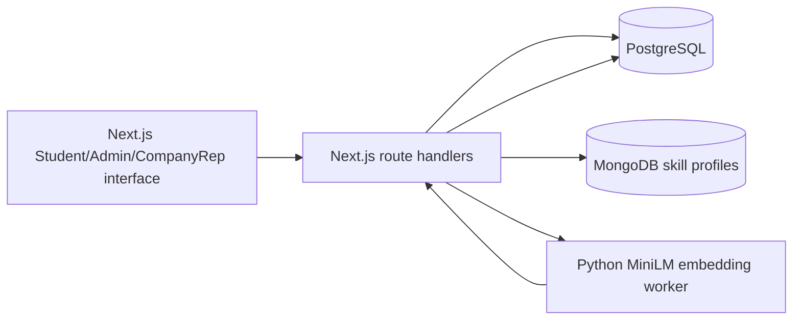

# CampusConnect — Smart College Placement & Internship Management System

## Project and team

| Item | Details |
|---|---|
| College | PES UNIVERSITY |
| Project | CampusConnect — Smart College Placement & Internship Management System |
| Member 1 | HEMANTH V — PES1UG25CS817 |
| Member 2 | SHREYAS K — PES1UG25CS845 |
| Project guide | PAVAN AC |
| Instructor approval | **Not verified in the repository.** Attach approval evidence if required. |

### Individual contributions

The repository does not contain a reliable task allocation or individual
contribution record. Do not infer one from the code or commit history. Each
member should complete and verify their own contribution description before
submission.

| Member | Database contribution | Application contribution | Evidence / confirmation |
|---|---|---|---|
| HEMANTH V | `[Complete with the member; not verified here.]` | `[Complete with the member; not verified here.]` | `[Add approved evidence.]` |
| SHREYAS K | `[Complete with the member; not verified here.]` | `[Complete with the member; not verified here.]` | `[Add approved evidence.]` |

## Abstract

CampusConnect is a web application for college placement and internship
workflows. It stores account, student, company, opportunity, application,
interview, offer, and placement records in PostgreSQL. MongoDB is used for
flexible student skill profiles. A separately hosted
`sentence-transformers/all-MiniLM-L6-v2` worker creates 384-dimensional
embeddings that PostgreSQL stores as arrays; the application ranks eligible
opportunities using cosine similarity.

The repository includes student registration and authentication, opportunity
browsing and full-text search, student application workflows, a Student-facing
semantic recommendation form, MongoDB skill analytics for Admins, relational
views/constraints/triggers, and SQL demonstration/verification scripts. Live
local database checks confirm the configured PostgreSQL semantic storage and
MongoDB collection setup, but there is no verified authenticated
browser-to-live-recommendation demonstration. The MongoDB profile collection
was empty at the time of the read-only check.

## Problem statement

Students need a reliable way to discover placement and internship
opportunities, assess their fit, and track application progress. Placement
staff also need consistent records linking students, companies, opportunities,
applications, interviews, offers, and outcomes. CampusConnect models these
relationships in a relational database and adds flexible skill profiles and
semantic matching for opportunity discovery.

This is a meaningful recruitment/placement workflow rather than only a
generic CRUD example: it includes eligibility filters, duplicate-application
prevention, relational reporting, full-text search, role-checked access, a
NoSQL aggregation, and semantic retrieval.

## Dataset, sourcing, and originality

The source and provenance of the existing PostgreSQL records have not been
independently verified. This report does not claim that they came from a real
college, public dataset, or official source, and it does not claim that every
record was generated as sample data. The application uses database records
for functional demonstration and testing; that working functionality is not
formal evidence of dataset origin or preparation. Dataset source attribution,
license or permission, formal exploration, and preprocessing history remain
undocumented and must be established before submission. No CSV, TSV, or
spreadsheet dataset file was found in the repository. The MongoDB profile
collection was empty during live verification.

The recommendation model is a pinned pretrained public sentence-embedding
model. No project-specific model training or labeled recommendation dataset
is present in the inspected implementation. The project includes application
logic and database design beyond a basic CRUD example, but originality
relative to other teams' work cannot be independently established from this
repository. Cite the pretrained model and other external dependencies in the
final academic submission and complete any required originality statement.

## Objectives

1. Represent college placement entities and their relationships with
   relational keys and integrity constraints.
2. Provide a Next.js interface for student authentication, opportunity
   discovery, applications, and recommendations.
3. Use PostgreSQL for authoritative relational records and MongoDB for
   flexible skill-profile documents.
4. Demonstrate database features including transactions, constraints, views,
   triggers, indexes, full-text search, and MongoDB aggregation.
5. Generate and cache sentence embeddings and rank eligible opportunities
   using cosine similarity.
6. Document test evidence, deployment prerequisites, and limitations without
   claiming unverified results.

## Scope and supported workflows

### Student

- Public registration creates Student accounts; sign-in uses the existing
  signed-session authentication.
- Browse and full-text search placement and internship opportunities.
- Submit an application and view applications belonging to the signed-in
  student's profile.
- Submit interests and career preferences in the Student semantic
  recommendation panel. Student identity and GPA are resolved server-side from
  the session; no student ID is sent by the recommendation UI.
- Student skill-profile `GET` and `PUT` APIs exist. A dedicated skill-profile
  editor is not present in the current page.

### Admin

- The dashboard in `app/components/admin-dashboard.tsx` displays the
  opportunity list, latest 50 applications with a total count, and skill
  analytics.
- `GET /api/analytics/skill-proficiency` runs a MongoDB aggregation grouped by
  normalized skill and proficiency without returning student identifiers.
- Its **Regenerate stale embeddings** action calls the existing Admin-only
  endpoint after an explicit click. Regeneration may write PostgreSQL
  embedding rows; it does not run automatically.
- `POST /api/admin/semantic-embeddings` accepts Admin-only semantic content
  updates and generates or refreshes opportunity embeddings. It can write to
  PostgreSQL and requires the embedding worker.

### Company representative

The `CompanyRep` role has an implemented read-only dashboard. The page renders
`app/components/company-representative-dashboard.tsx`, and
`GET /api/company/dashboard` requires a signed `CompanyRep` session. It
resolves the representative's linked company from `company_reps` using the
session `userId`, then returns only that company's opportunities and
applications for those opportunities. No client-supplied company or student
ID determines ownership, and resume URLs/account identifiers are not returned.
Opportunity creation and editing are not implemented. Live account-to-company
ownership has not been verified by an authenticated browser/API demonstration.

## Requirements compliance map

The only project requirements PDF found in the repository is
[`DBMS Level 3 Project Requirements draft.pdf`](DBMS%20Level%203%20Project%20Requirements%20draft.pdf).
This map covers its 18 numbered items across four pages. Source implementation
is distinguished from live execution and demonstration. The separately named
assignment PDFs were not found and are not used to invent requirements.

| ID / PDF page | Requirement summary | Status | Implementation and evidence / remaining verification |
|---|---|---|---|
| R1 / p.1 | Unique title, meaningful problem, beyond CRUD | Partially verified | Title, problem statement, and non-CRUD workflows are documented in this report and [README.md](README.md); code includes eligibility filters, duplicate prevention, full-text search, aggregation, and semantic ranking. Uniqueness against other teams cannot be verified. |
| R2 / p.1 | Approved two-member team; responsibilities and contribution to DB and application | Partially verified | Two members are named above. Instructor approval and individual DB/application contributions remain TODO; Git history is not substituted for member-confirmed contributions. |
| R3 / p.1 | Practical SQL and NoSQL; two or more paradigms minimum | Partially verified | PostgreSQL integration is in `lib/db.ts`; Mongo integration and Admin aggregation are in `lib/mongodb.ts` and `app/api/analytics/skill-proficiency/route.ts`. The collection was confirmed but had zero documents on 2026-11-20, so populated profile behavior is unverified. PostgreSQL arrays/cosine ranking are not a separate vector database. Confirm with the instructor whether the PDF's “two (Minimum)” wording requires a dedicated vector store in addition to SQL and NoSQL; R8 labels semantic search optional but recommended. |
| R4 / p.1 | ER diagram, relational mapping, entities, attributes, keys, relationships, constraints; NoSQL/vector models | Implemented in source/docs | See [db/er-diagram.mmd](db/er-diagram.mmd), [db/schema.sql](db/schema.sql), [db/relational-schema.md](db/relational-schema.md), [db/data-dictionary.md](db/data-dictionary.md), [db/mongodb-design.md](db/mongodb-design.md), and [db/semantic-vector-search.sql](db/semantic-vector-search.sql). PostgreSQL objects were checked read-only on 2026-11-20. |
| R5 / p.1–2 | DDL including CREATE, ALTER, DROP, keys, constraints, indexes, views | Implemented in source/scripts | Base DDL is in `db/schema.sql`; disposable-database examples are in `db/ddl-demonstration.sql`; keys, indexes, views, and constraints are present. The demonstration script's execution is not claimed here. |
| R6 / p.2 | DML and joins, grouping, HAVING, ordering, aggregates, subqueries | Implemented in source/scripts | Application submission inserts in `app/api/applications/route.ts`; `db/dml-demonstration.sql` and `db/queries.sql` show additional operations. Not every example was re-executed during this audit. |
| R7 / p.2 | At least four advanced database concepts | Implemented in source; live verification partial | Views, trigger functions/triggers, indexes, full-text search, Mongo aggregation, and cosine similarity are present. PostgreSQL catalog evidence is recorded below; Mongo aggregation returned zero rows because the collection was empty. |
| R8 / p.2 | Optional/recommended embeddings, storage, similarity, retrieval explanation | Implemented in source; end-to-end verification pending | The pinned MiniLM worker and route use 384D vectors stored in PostgreSQL arrays and application-side cosine ranking. Five opportunity vectors and one student vector were verified 2026-11-20; a fresh authenticated live browser flow is not independently verified. |
| R9 / p.2 | Functional Next.js interface for database features | Implemented in source; manual demo pending | `app/page.tsx` implements Student workflows, renders the Admin dashboard in `app/components/admin-dashboard.tsx`, and renders the read-only CompanyRep dashboard in `app/components/company-representative-dashboard.tsx`. The CompanyRep UI/API source is implemented, but live authenticated ownership and its live HTTP route are not verified. Opportunity creation/editing is not implemented. |
| R10 / p.3 | Backend/API database integration; environment-based secrets | Implemented in source | Next.js routes use `lib/db.ts` and `lib/mongodb.ts`; environment-variable names are in [README.md](README.md). Secret values are not included. |
| R11 / p.3 | Authentication and authorization, at least two relevant roles | Implemented in source | Signed sessions and `requireRole` are in `lib/auth.ts`; Student and Admin routes enforce role checks. The CompanyRep dashboard and `/api/company/dashboard` route are role-gated and scope SQL by the authenticated user ID. The live role/account linkage remains unverified, and the dashboard is read-only. |
| R12 / p.3 | Database-level input validation and integrity | Implemented in source/schema | PostgreSQL constraints/triggers are in `db/schema.sql`; Mongo validator/index setup is in `db/mongodb-setup.js`; API handlers validate input. Live MongoDB had its validator/index but no documents. |
| R13 / p.3 | Basic security; no plaintext passwords or credentials | Implemented in source/configuration | Password hashing and signed-session handling are in `lib/auth.ts`; connection settings use server-side environment variables. Production secret configuration remains an operator prerequisite. |
| R14 / p.3 | Documentation, design, queries, architecture, screenshots, tests, conclusion/future work | Partially complete | README, this report, and database docs cover design/workflows. Three images exist under `evidence/`, but their capture context/approval is unverified and they need privacy/cleanliness review. Dataset exploration and member contributions remain missing. |
| R15 / p.3 | Git/GitHub, individual contribution evidence, README setup | Partially verified | A Git worktree and setup README exist. GitHub hosting and commits demonstrating each member's contribution were not verified in this audit. |
| R16 / p.3–4 | Final demonstration includes design, implementation, queries, UI, integration, advanced features, tests, contributions | Partially complete | Code/docs support the technical demo; see the [manual checklist](README.md#final-manual-demo-checklist). A live presentation and member-specific contribution evidence remain to be completed. |
| R17 / p.4 | Original design; no direct copying; distinction from other teams | Cannot verify | This repository contains a specific implementation, but cross-team comparisons, source attribution review, and plagiarism assessment are outside the available evidence. Complete required citations and the team originality statement. |
| R18 / p.4 | Level 3: beyond CRUD; connect database concepts, design, implementation, and web application | Implemented in source; demonstration pending | Relational constraints/query design, Mongo aggregation, semantic eligibility/ranking, and role-based Next.js workflows are connected in code and docs. An instructor-facing demonstration remains necessary. |

### Dataset, method, and evidence TODOs

- **Dataset/source provenance:** document the actual approved source or
  collection method, access date, owner, and source records. Existing database
  rows do not establish provenance.
- **License/permission:** cite the actual license or document permission; do
  not assume that a publicly available source is unrestricted.
- **Exploration:** add reproducible, non-sensitive counts, distributions,
  missingness, and outlier findings from the approved dataset.
- **Preprocessing:** document transformations, validation, deduplication, and
  exclusions actually performed; do not infer them from the schema.
- **Methodology/results:** document recommendation evaluation and measured
  results only after a reproducible experiment. The model is pretrained; no
  project-specific training dataset/run is verified here.
- **Screenshots/privacy:** inspect existing images under `evidence/`, confirm
  their capture context and approval, redact identifying details, and capture
  clean genuine screens where needed.
- **Team/originality:** obtain instructor approval evidence, member-confirmed
  contributions, required external citations, and the originality statement.
- **Other PDFs:** Main Guidelines, Deliverables, Assessment and Plagiarism
  Policy, Dataset Exploration, and Models and Training Guidelines were not
  found; requirements unique to those documents remain unverified.

## System architecture and technology choices

| Component | Technology / responsibility |
|---|---|
| Browser interface | Next.js App Router, React, TypeScript, Tailwind CSS |
| API/backend | Next.js route handlers; request validation, signed-session checks, authorization, database access |
| Relational system | PostgreSQL 18; accounts, academic records, opportunities, applications, placement workflow, views, and semantic arrays |
| Flexible profile store | MongoDB; `campusconnect.student_skill_profiles` |
| Embedding service | Python 3.12, PyTorch CPU, Transformers; model loaded once outside the Next.js request process |
| Model | `sentence-transformers/all-MiniLM-L6-v2`, pinned revision `1110a243fdf4706b3f48f1d95db1a4f5529b4d41` |
| Role interfaces | Separate Student, Admin, and read-only CompanyRep rendering in `app/page.tsx` |

The browser calls Next.js routes. PostgreSQL is accessed through
`lib/db.ts`; MongoDB is accessed server-side through `lib/mongodb.ts`. The
recommendation route resolves the authenticated user's PostgreSQL student row,
loads only that student's MongoDB skills, and reads eligible opportunities
and their stored vectors from PostgreSQL. The embedding worker is a separate
loopback HTTP service by default.

PostgreSQL is the authoritative store for strongly related placement records
and integrity constraints. MongoDB holds the variable-length skill-profile
document separately from those relational records. The recommendation
implementation stores fixed-dimension vectors as PostgreSQL arrays and uses
exact application-side cosine ranking; a dedicated vector extension/index was
not selected or verified for the current corpus.

The project uses the existing PostgreSQL and MongoDB services for relational
and flexible data. Semantic vectors are persisted as PostgreSQL `real[]`;
pgvector, Atlas Vector Search, and an ANN index are not used.

## Relational design

The base schema is exported in [`db/schema.sql`](db/schema.sql). The ER model
is available as Mermaid source in [`db/er-diagram.mmd`](db/er-diagram.mmd).
The table/column dictionary and relational mapping are in
[`db/data-dictionary.md`](db/data-dictionary.md) and
[`db/relational-schema.md`](db/relational-schema.md).

### Base tables and keys

| Table | Primary key | Principal foreign keys / relationship |
|---|---|---|
| `users` | `user_id` | Referenced by student and company-representative profiles |
| `students` | `student_id` | `user_id` → `users`; `dept_id` → `departments`; `user_id` is unique |
| `departments` | `dept_id` | Referenced by students |
| `companies` | `company_id` | Referenced by representatives and opportunities |
| `company_reps` | `rep_id` | `company_id` → `companies`; `user_id` → `users` and is unique |
| `opportunities` | `opp_id` | `company_id` → `companies` |
| `applications` | `app_id` | `student_id` → `students`; `opp_id` → `opportunities`; unique `(student_id, opp_id)` |
| `interviews` | `interview_id` | `app_id` → `applications`; multiple interviews per application are allowed |
| `offers` | `offer_id` | `app_id` → `applications` and is unique |
| `placements` | `placement_id` | `offer_id` → `offers` and is unique |

Applications implement the student/opportunity many-to-many relationship.
Foreign-key columns are non-null in the base schema. Foreign keys do not
specify custom `ON DELETE`/`ON UPDATE` actions. More detailed cardinalities are
in the relational-schema document.

### Constraints, defaults, views, triggers, and indexes

- **Unique constraints:** unique usernames, department names, company names,
  student user IDs, representative user IDs, student/opportunity application
  pairs, offer application IDs, and placement offer IDs.
- **Checks:** roles are `Student`, `CompanyRep`, or `Admin`; GPA and optional
  minimum GPA are within 0–10; graduation year is at least 2000; opportunity
  type is `Placement` or `Internship`; salary and offer amount are
  non-negative; application, interview, offer, and placement statuses are
  restricted to the schema's enumerated values.
- **Defaults:** integer primary keys use sequences. Application, offer, and
  status fields have the defaults recorded in the schema; for example,
  application date defaults to `CURRENT_DATE` and application status defaults
  to `Applied`.
- **Views:** `vw_interview_schedule`, `vw_placement_report`, and
  `vw_student_applications`.
- **Triggers and functions:** `trg_validate_student_gpa` calls
  `fn_validate_student_gpa()` before student insert or GPA update and rejects
  out-of-range values (also covered by a CHECK).
  `trg_validate_placement_offer` calls `fn_validate_placement_offer()` before
  placement insert or `offer_id` update and requires an accepted offer.
- **Base B-tree indexes:** `idx_applications_opp_id`,
  `idx_applications_status`, `idx_applications_student_id`,
  `idx_company_reps_company_id`, `idx_interviews_app_id`,
  `idx_interviews_date`, `idx_offers_status`,
  `idx_opportunities_company_id`, `idx_opportunities_deadline`,
  `idx_placements_status`, and `idx_students_dept_id`.
- **Full-text indexes:** the migration adds
  `idx_opportunities_search_gin` and `idx_companies_search_gin` GIN expression
  indexes. Semantic tables use primary/foreign-key indexes, not a vector index.

The base schema and live PostgreSQL catalog were checked read-only on
2026-11-20. The database had the ten expected base tables plus the three
semantic tables, three views, trigger functions/triggers, and full-text search
indexes.

### Additive semantic storage

`db/semantic-vector-search.sql` defines:

- `opportunity_semantic_content`: one row per opportunity, with optional
  description, required skills, and update timestamp.
- `opportunity_semantic_embeddings`: one vector per opportunity, keyed and
  foreign-keyed by `opp_id`.
- `student_semantic_embeddings`: one vector per student, keyed and
  foreign-keyed by `student_id`.

Embedding rows include model name, pinned revision, SHA-256 source hash,
generation timestamp, and `real[]` vector. Checks enforce the model/revision,
hash format, 384 dimensions, and finite components. Opportunity semantic
content is separate because the base opportunities table has no description
or required-skills fields.

## MongoDB design and aggregation

The MongoDB namespace is database `campusconnect`, collection
`student_skill_profiles`. A document holds an Int32 `studentId`, a variable
length `skills` array with `name` and `proficiency`, timestamps, and a schema
version. The setup script defines a strict JSON Schema validator and the
unique `studentId_unique` index; MongoDB also provides its built-in `_id_`
index. The design is documented in [`db/mongodb-design.md`](db/mongodb-design.md).

The Admin analytics route unwinds skills, normalizes names, deduplicates
profile/skill/proficiency combinations, and returns aggregate counts. Live
read-only verification confirmed the collection, strict validator, and unique
index, but found zero profile documents. The aggregation executed and returned
zero rows. Actual populated-document behavior remains unverified.

## Authentication and authorization

Passwords are hashed with Node's scrypt implementation. The application uses
signed, expiring sessions and role checks. Public registration permits Student
accounts only. Student application, skills, and recommendation routes require
a Student session. Student identity is resolved from the signed-in
`userId` through PostgreSQL; the recommendation endpoint rejects
client-supplied identity fields. Admin analytics and opportunity embedding
generation require an Admin session.

The session is stateless and has a finite expiry; the current helper does not
recheck the account's role on every request or provide revocation. Production
must configure `AUTH_SESSION_SECRET`. Keep all database credentials and
session secrets server-side and out of `NEXT_PUBLIC_` variables.

## Semantic recommendation pipeline

1. **Student source text:** skill names and proficiency levels from the
   authenticated student's MongoDB profile, plus submitted interests and
   career preferences. Names, GPA, and account identifiers are not embedded.
2. **Opportunity source text:** title, job type, company name/industry, and
   optional description/required skills from
   `opportunity_semantic_content`.
3. **Model:** pinned `sentence-transformers/all-MiniLM-L6-v2`; the worker
   tokenizes, attention-mask mean-pools token embeddings, and L2-normalizes
   each 384-value vector.
4. **Caching/storage:** source hashes include model/revision and assembled
   text. Matching student vectors are reused; a cache miss generates and
   upserts a vector. Admin generation creates or refreshes opportunity
   vectors. Student interests/preferences are not stored as plaintext.
5. **Eligibility and retrieval:** PostgreSQL filters opportunities by
   `deadline >= CURRENT_DATE` and `(min_gpa IS NULL OR min_gpa <= student_gpa)`.
   The route rechecks eligibility and excludes opportunities whose embedding
   source hash no longer matches current source text.
6. **Ranking:** exact cosine similarity
   `dot(a,b) / (||a|| * ||b||)` is calculated in the application. Zero vectors
   score zero; only positive scores are returned, sorted descending with
   opportunity ID as a deterministic tie-breaker, limited to ten results.

This is genuine sentence-embedding retrieval, not lexical TF-IDF and not a
production vector-database/ANN search. A lexical TF-IDF implementation remains
available only as an explicitly named comparison mode.

## Testing and verification results

### Automated checks

The following results were observed during implementation and verification:

| Check | Result |
|---|---|
| `npm run lint` | Passed |
| `npx tsc --noEmit` | Passed |
| `npm run test:semantic` | 9 passed, 0 failed |
| `python -m unittest discover -s tests -p test_semantic_embedding_service.py` | 4 passed, 0 failed |
| Direct Node test for `tests/company-representative.test.mts` | 2 passed, 0 failed |
| `npm run build` | Passed |

The Python unit tests use a fake model and loopback service; TypeScript tests
mock the worker response for client validation. These unit tests do not prove
live authenticated recommendation behavior. A real model demo was documented
as run locally in `db/README.md`; no new inference was run as part of the
current report preparation.

The CompanyRep test file verifies only that role authorization accepts the
CompanyRep role and rejects other/absent sessions, and that both dashboard SQL
queries receive the authenticated representative's user ID and exclude resume
URLs. It does not create an HTTP request, authenticate a live account, query a
database, or prove live company/representative ownership isolation.

### Live read-only database checks

The PostgreSQL semantic check found five opportunity vectors and one student
vector. All six were 384-dimensional, finite, approximately unit-normalized,
and carried the expected model/revision and valid hash format. All five
opportunity hashes matched current assembled source text and linked to
existing opportunities/companies. Four opportunities passed the stored
student vector's live GPA/deadline filter and had current-model vectors.

The student vector linked to an existing student, but its source hash could
not be recomputed because MongoDB had no profile documents and interests and
career preferences are request-scoped. The MongoDB aggregation returned zero
rows because its collection was empty.

No authenticated browser-to-live-database recommendation request was
independently verified during this report audit. The repository does contain
screenshots showing Student pages, including a recommendation result view;
their capture context and database connection are not independently confirmed.
The API can persist a student vector on a cache miss; therefore a fresh
end-to-end demonstration should use an approved development database and
Student account. The Student UI has been linted, type-checked, and included in
the successful production build.

## Limitations and future enhancements

- The MongoDB profile collection was empty during live verification, so
  populated-profile aggregation and skill-based recommendations still need a
  synthetic or approved test profile in a dedicated development database.
- The project report cannot establish source provenance for the existing
  opportunity data. Add the approved dataset/source, licensing or collection
  method, exploration, and preprocessing details before submission.
- The recommendation UI and APIs are implemented, but authenticated
  end-to-end browser behavior remains unverified.
- No project-specific embedding-model training or offline recommendation
  benchmark is documented. The implementation uses a pretrained public model.
- The CompanyRep dashboard is implemented in read-only form. Live
  account-to-company ownership and the HTTP route are not verified. CompanyRep
  opportunity creation/editing is not implemented.
- The Admin dashboard is implemented; its live skill analytics depend on
  configured MongoDB data.
- The Mermaid ER diagram is source text; a rendered image may be required for
  presentation materials.
- Three screenshots are present under `evidence/`. Their provenance is not
  verified; at least one visibly contains development UI chrome and the
  images contain student/application information. Review and recapture them
  safely before submission.

Possible future work (not implemented): add a reviewed CompanyRep
opportunity creation/editing workflow if required, add a reviewed opportunity
skill taxonomy, evaluate
recommendations against an approved, non-sensitive benchmark; and consider a
dedicated vector index if dataset scale justifies it.

## Conclusion

CampusConnect connects a relational placement workflow to a Next.js
application, adds a MongoDB skill-profile integration, and implements semantic
opportunity ranking with persisted embeddings. Source-level implementation,
database schema evidence, and automated checks support these claims. The
remaining submission risks are evidence and verification gaps rather than
claims that should be filled with invented data: dataset provenance and
exploration, instructor approval and individual contributions, privacy-safe
screenshots, populated MongoDB profile behavior, and a fresh authenticated
end-to-end demonstration.

## Submission evidence still to provide

- [ ] Instructor approval evidence for the two-member team, if required.
- [ ] Accurate individual contributions from each member, with evidence.
- [ ] Dataset source/provenance and exploration/preprocessing documentation.
- [ ] Review existing screenshots
  [`evidence/student-dashboard.png`](evidence/student-dashboard.png),
  [`evidence/student-application.png`](evidence/student-application.png), and
  [`evidence/semantic-recommendations.png`](evidence/semantic-recommendations.png)
  for capture provenance, approval, personal information, and development
  overlays; recapture cleanly where necessary:
  - Student sign-in and opportunity/search interface.
  - Student semantic preference form and actual result list, or a clearly
    labeled genuine empty/error result.
  - Student application list.
  - Admin aggregation/generation API evidence if requested; redact all
    credentials, cookies, student identifiers, and personal details.
- [ ] Authenticated Student-to-live-database recommendation demonstration in a
  development environment.
- [ ] Admin dashboard demonstration, including skill analytics availability
  and the manually triggered embedding action in a development environment.
- [ ] CompanyRep dashboard demonstration with an account whose
  `company_reps` row is known to be linked to the expected company; confirm
  company-only opportunities and applications, with no resume URLs or account
  identifiers. Do not present opportunity creation/editing because it is not
  implemented.
- [ ] Any submission format, rubric, plagiarism policy, dataset, or model
  training requirements not contained in the available assignment PDF.

## Assignment-document availability

The repository contains only
[`DBMS Level 3 Project Requirements draft.pdf`](DBMS%20Level%203%20Project%20Requirements%20draft.pdf).
The separately requested Main Guidelines, Deliverables, Assessment and
Plagiarism Policy, Dataset Exploration, and Models and Training Guidelines
documents were not found. This report does not invent requirements from those
missing materials.
