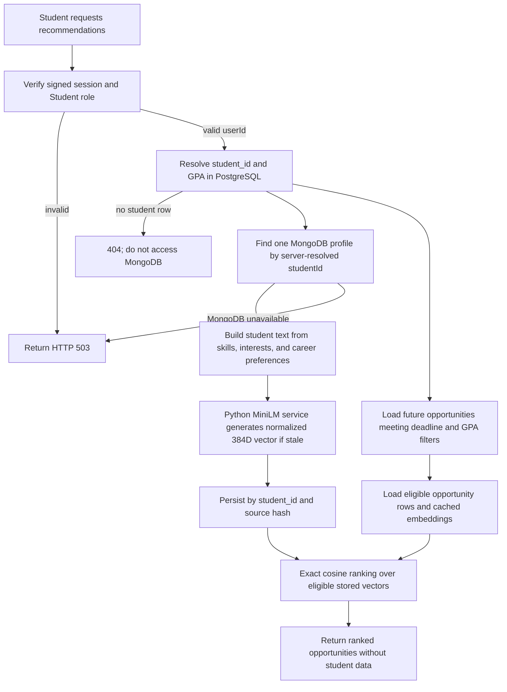

# CampusConnect MongoDB Design

**Status:** The application includes server-side MongoDB profile access,
Admin aggregation, and a local sentence-embedding recommendation path. A
read-only check on 2026-11-20 confirmed PostgreSQL 18.6 semantic storage with
five opportunity vectors and one student vector. All six were 384-dimensional
finite vectors; the five opportunity source hashes matched current assembled
source text. The same check confirmed MongoDB database `campusconnect`, the
`student_skill_profiles` validator, and its unique `studentId` index. The
collection contained zero documents and its aggregation returned zero rows.
An authenticated end-to-end recommendation request has not been tested. See
`db/README.md` for the model, vector schema, commands, test results, and
example similarities.

## Purpose and responsibility split

MongoDB stores flexible student skill profiles: each profile contains
a variable-length list of skill records that can evolve without adding
student-specific columns to PostgreSQL. PostgreSQL remains authoritative for
account identity, student records, companies, opportunities, applications, and
future opportunity skill requirements. MongoDB data is profile input for
recommendations; it does not replace a PostgreSQL student row or authorize a
request.

The current PostgreSQL `public.opportunities` table contains `opp_id`,
`company_id`, `title`, `type`, `salary`, `deadline`, and `min_gpa`. It has no
description or skill-requirement columns in the base schema. Optional
opportunity descriptions and required skills are stored separately in
`public.opportunity_semantic_content`. The semantic recommender uses those
fields when present; the explicit lexical fallback uses existing opportunity
and company text.

## MongoDB namespace

- **Database:** `campusconnect`
- **Collection:** `student_skill_profiles`
- **Document cardinality:** At most one profile document per PostgreSQL
  student, enforced by a unique index on `studentId`.

The application uses the official `mongodb` Node.js driver. The server-side
names are `MONGODB_URI` and `MONGODB_DATABASE`; their current configuration is
server-side only. A read-only connection check on 2026-11-20 reached the
configured `campusconnect` database. Neither setting may be exposed through a
`NEXT_PUBLIC_` variable.
`db/mongodb-setup.js` creates the collection validator when the collection is
new and ensures the unique owner index. It does not replace a validator on an
existing collection.

## Representative document

The values below are synthetic. This is MongoDB Extended JSON-style
documentation, not an existing record:

```json
{
  "_id": { "$oid": "665f1a2b3c4d5e6f708192a3" },
  "studentId": { "$numberInt": "1042" },
  "skills": [
    { "name": "typescript", "proficiency": "intermediate" },
    { "name": "postgresql", "proficiency": "advanced" },
    { "name": "git", "proficiency": "beginner" }
  ],
  "createdAt": { "$date": "2026-08-15T10:30:00.000Z" },
  "updatedAt": { "$date": "2026-11-20T06:45:00.000Z" },
  "schemaVersion": { "$numberInt": "1" }
}
```

### Field definitions and validation

| Field | BSON type | Meaning and validation |
|---|---|---|
| `_id` | `ObjectId` | MongoDB document identifier. Required and generated by MongoDB when omitted. The built-in `_id_` index makes it unique. It is not the PostgreSQL student identifier. |
| `studentId` | `Int32` | Required positive integer within the PostgreSQL `integer` range (1 through 2,147,483,647), equal to `public.students.student_id`. It identifies the profile's PostgreSQL owner, not the authenticated principal. The application must resolve it from the verified session and PostgreSQL; clients must not choose it. |
| `skills` | Array of documents | Required; up to 100 skill entries. An empty array is valid for a profile that has not yet been filled in. |
| `skills[].name` | String | Required, 1-80 characters after normalization. Normalize with Unicode NFC, trim leading/trailing whitespace, collapse internal whitespace, and apply locale-independent lowercase. Preserve punctuation (`c++`, `c#`, `.net`). Reject blank names and control characters. |
| `skills[].proficiency` | String | Required enum: `beginner`, `intermediate`, `advanced`, or `expert`. Reject other values. The current local cosine ranker uses skill-name text; proficiency does not change eligibility or score. |
| `createdAt` | BSON `Date` | Required UTC creation timestamp, set by the server on first insert and not changed on updates. |
| `updatedAt` | BSON `Date` | Required UTC timestamp, set by the server on insert and refreshed on each successful profile write. Must not precede `createdAt`. |
| `schemaVersion` | Int32 | Required positive integer. Initial value is `1`; increment only with a documented migration when the document shape changes. |

The setup script's collection validator requires these fields, BSON types,
proficiency enum, positive `studentId`/`schemaVersion`, and the `skills`
array/object structure. It rejects unknown top-level and skill-entry fields.
The application additionally rejects
duplicate skills after normalization: two entries whose normalized `name`
values are equal are duplicates, even if their input casing or spacing differs.
Reject duplicates rather than silently merging proficiency values.

The profile contains no name, email, username, GPA, password, password hash,
session token, resume, or other unnecessary personal data. Names and GPA are
read from PostgreSQL when needed.

## Indexes

MongoDB creates the unique `_id_` index for each collection by default. Keep
that built-in index; do not create a second index on `_id`.

The setup script creates one additional index:

| Index | Definition | Reason |
|---|---|---|
| `studentId_unique` | `{ studentId: 1 }`, `unique: true` | Enforces one profile per PostgreSQL student and supports the authenticated student's exact profile lookup. |

A multikey index on `skills.name` is **not** created. The recommendation
request loads one profile by the already-resolved `studentId`, then compares
its small skill list in application code with text from PostgreSQL opportunity
and company fields. It does not search the collection for students by skill.
Add a multikey index only if a later, approved feature queries profiles by
skill (and its privacy requirements are reviewed); it does not improve the
current recommendation query. No index on `updatedAt` or `schemaVersion` is
needed for the described access pattern.

## Identity, authorization, and profile retrieval

The inspected login creates a signed session containing `userId`, `username`,
and `role`; `lib/auth.ts` reads and verifies the session and `requireRole`
checks roles. The session's `userId` is the PostgreSQL `users.user_id`, **not**
`students.student_id`. In the current schema, `students.user_id` is a
foreign key to `users.user_id` and is UNIQUE. The student and application
routes resolve the current student's `student_id` from PostgreSQL using the
session `userId`.

The `GET`/`PUT /api/student/skills` and `POST /api/vector-recommendations`
routes follow that server-side identity path:

1. Read the session with `getSessionUser(request)` and require the `Student`
   role.
2. Resolve `student_id` (and GPA for recommendations) from
   `public.students` using the session's `userId`.
3. Use only that resolved `student_id` in MongoDB filters and writes. Do not
   accept a client-supplied `student_id` as an owner selector; ignore or reject
   such a field.
4. Return only the authenticated student's profile. Company representatives
   and other students must not use these endpoints to retrieve it.

MongoDB credentials and the client stay in the server-only
`lib/mongodb.ts`; do not place credentials in browser bundles or
`NEXT_PUBLIC_` variables. The analytics route is
`GET /api/analytics/skill-proficiency` and requires an Admin session; it
returns profile counts by skill/proficiency without student identifiers.

The existing session is stateless and has an eight-hour expiry; the current
helper does not re-read the user's role on each request or provide revocation.
That is an existing authentication limitation, not something MongoDB should
weaken or work around. The new endpoints should rely on the verified session
helper and database ownership lookup, not client-side filtering.

## Semantic embedding recommendations

The current default for `POST /api/vector-recommendations` is genuine semantic
embedding retrieval using `sentence-transformers/all-MiniLM-L6-v2`. The
standalone Python service runs on CPU and loads the model once, outside the
Next.js process. It tokenizes text, attention-mask mean-pools the model's token
representations, and L2-normalizes each 384-dimensional output. The tested
local runtime is Python 3.12.10, PyTorch 2.13.0 CPU, and Transformers 5.16.1.
The model revision is pinned to
`1110a243fdf4706b3f48f1d95db1a4f5529b4d41`. First use downloads model weights
once; no paid API or API key is required.

The student embedding source is built from MongoDB profile skill names and
proficiency levels plus request-scoped interests and career preferences. It
does not contain name, GPA, user ID, or student ID. Opportunity vectors use
PostgreSQL opportunity title/type, company name/industry, and optional
description/required skills in `public.opportunity_semantic_content`. The
original `public.opportunities` table does not have description or skill
requirements; Admins must add approved real values through
`POST /api/admin/semantic-embeddings`. No source opportunity data is invented.

PostgreSQL stores embeddings in additive `real[]` tables:

- `public.student_semantic_embeddings`, keyed by and foreign-keyed to
  `public.students.student_id`.
- `public.opportunity_semantic_embeddings`, keyed by and foreign-keyed to
  `public.opportunities.opp_id`.

Each row includes model name, SHA-256 source hash, generation time, and exactly
384 finite vector values. Hashing includes the model and assembled text.
Student vectors are cached and regenerated only after profile/preferences
change. Opportunity vectors are only regenerated when an Admin invokes the
generation route and the source hash changed. Initial existing-opportunity
population is an explicit Admin generation step. The migration is
`db/semantic-vector-search.sql`; it has been applied to the verified local
development database. Read-only checks observed five opportunity vectors and
one student vector. The student's exact source text could not be reconstructed
because the MongoDB collection was empty and preferences are request-scoped.
Interests and career preferences are request-scoped and not stored as
plaintext; only the derived vector and source hash are persisted for that
student.

The route first loads the authenticated student's GPA and only eligible
opportunities (deadline today or later and `min_gpa` null or satisfied).
It compares the student's vector against each current stored opportunity
vector with cosine similarity:
`dot(student, opportunity) / (norm(student) * norm(opportunity))`. Zero vectors
score zero. Results with zero similarity are omitted, and the rest are sorted
by score descending then opportunity ID ascending. This is exact retrieval
over the eligible result set; the local PostgreSQL installation does not
include pgvector, so vectors are stored as PostgreSQL arrays and no ANN index
is used.

The embedding service binds to loopback `127.0.0.1:8008`; it loads once per
process and handles bounded batches. Next.js does not download the model or
run CPU inference in its request process. A missing worker, migration, or
opportunity embedding returns an explicit service error, not lexical results
disguised as semantic search.

For comparison only, request `"mode": "lexical"` to use the prior TF-IDF
implementation in `lib/vector-search.ts`. Its response mode is
`lexical-tfidf-cosine`; it is not an embedding or semantic search method.

See `db/README.md` for exact PowerShell setup, Admin generation commands,
Student retrieval, a real-model example, and tests.

## Legacy lexical fallback

When explicitly requested, `mode: "lexical"` builds TF-IDF sparse vectors from
the authenticated student's stored skill names plus request interests and
career preferences, then compares them with existing opportunity title, type,
company name, and industry text.

This is a deterministic local lexical-vector fallback, not a production
vector database or learned embedding. It does not apply the
planned `required`/`preferred` skill rules below because no opportunity skill
requirements exist in the exported schema. Missing profiles are identified
with `profileFound: false`; a MongoDB error returns HTTP 503 rather than an
empty success response.

## Future PostgreSQL skill requirements

The current exported schema has no opportunity skill requirements. Phase 2
must review and add a PostgreSQL representation before skill matching can be
called complete. A normalized `public.opportunity_skills` relation is the
recommended starting point, with an `opp_id` foreign key to
`public.opportunities(opp_id)`, a canonical `skill_name`, a `requirement_type`
(`required` or `preferred`), and a uniqueness rule preventing duplicate
canonical skills per opportunity. This is a proposal only: none of these
columns, constraints, or rows exist in the current schema.

For a future deterministic requirements matcher, use exact equality after
applying the same skill-name normalization to both profiles and requirements.
Do not claim synonym handling or semantic matching. A possible future
algorithm is:

1. Resolve the authenticated student and read `students.gpa` from PostgreSQL.
2. Read opportunities and their planned skill requirements from PostgreSQL.
   Use the existing `opportunities` columns `opp_id`, `title`, `type`,
   `deadline`, and nullable `min_gpa`; join `companies` if the response needs
   the company name.
3. Apply hard eligibility filters before scoring:
   - keep an opportunity only if `deadline` is today or later in the agreed
     campus business timezone;
   - if `min_gpa` is non-NULL, require `students.gpa >= min_gpa`;
   - if the opportunity has a required skill absent from the profile, exclude
     it from recommendations.
4. For remaining opportunities, score exact normalized skill-name matches.
   Proposed weights are 2 points per matched `required` skill and 1 point per
   matched `preferred` skill; divide matched weight by total requirement weight
   and multiply by 100. Profile proficiency is displayed but not used in this
   initial score. If an opportunity has no requirements, do not label it a
   skill-based recommendation; it can remain available in ordinary browsing.
5. Sort by descending score, then descending count of matched preferred
   skills, then earliest deadline, then ascending `opp_id` for a stable
   tie-break. Return the score, matched skill names, and a concise explanation
   for each result.

Recommendation reasons should be derived from values actually checked, for
example: “Meets the GPA and deadline criteria; matches TypeScript and Git
(2 of 3 listed skills).” Do not state that an opportunity is eligible if a
filter was not evaluated.

## Missing profiles and service failures

- If no MongoDB profile exists, return an explicit “complete your skills
  profile” state (`profileFound: false`). With no request interests, this
  yields no recommendations; request interests may still produce local demo
  matches. Do not interpret a missing document as a saved empty profile. An
  existing document with `skills: []` is valid but yields no skill matches.
- If PostgreSQL has no student row for the authenticated `userId`, return a
  not-found response and do not query or create a MongoDB profile.
- If MongoDB is unavailable, return a clear service error (for example HTTP
  503) for profile/recommendation routes. Do not silently return an empty
  profile or a success-shaped empty recommendation list. PostgreSQL-backed
  opportunity browsing can continue independently.
- Do not write recommendation results, opportunity data, or application data
  into MongoDB. Compute current eligibility from PostgreSQL and compare the
  student's MongoDB profile with PostgreSQL opportunity/company text.

## Consistency boundary

`studentId` is a logical cross-database reference, not a PostgreSQL foreign
key that MongoDB can enforce. Verify ownership against PostgreSQL on each
authorized request; keep PostgreSQL authoritative for student identity and
all placement workflow records. Keep opportunity requirements only in
PostgreSQL. There is no distributed transaction between the databases:
student/profile lifecycle changes can temporarily leave a stale MongoDB
document. A later implementation must define profile cleanup when a student is
deleted and should make cleanup retryable; it must not treat a MongoDB profile
as evidence that a PostgreSQL student exists.

## Recommendation request flow



## Remaining design decisions

- Approve a PostgreSQL `opportunity_skills` relation and whether requirements
  need a minimum proficiency level before implementing hard skill eligibility.
- Confirm the database timezone used by `CURRENT_DATE` to interpret deadlines.
- Define the student-deletion/profile-cleanup process and the production
  MongoDB deployment, network access, and secret-management configuration.
- Evaluate installing pgvector for indexed approximate retrieval if the
  opportunity corpus grows beyond the current exact-scan approach.
- Decide where a private embedding worker runs for deployment environments
  where Next.js cannot reach a loopback service. Remote worker URLs must use
  HTTPS and a server-only `SEMANTIC_EMBEDDING_TOKEN`; never place it in a
  `NEXT_PUBLIC_` variable. The local worker binds only to loopback.

## Evidence inspected

- [`schema.sql`](./schema.sql): `public.students`, `public.opportunities`,
  their constraints, and the absence of opportunity skill requirements.
- [`relational-schema.md`](./relational-schema.md) and
  [`data-dictionary.md`](./data-dictionary.md): current relational mappings
  and constraints.
- [`er-diagram.mmd`](./er-diagram.mmd): current entities and relationships.
- [`lib/auth.ts`](../lib/auth.ts), [`app/api/auth/login/route.ts`](../app/api/auth/login/route.ts),
  [`app/api/students/route.ts`](../app/api/students/route.ts), and
  [`app/api/applications/route.ts`](../app/api/applications/route.ts): session
  identity and server-side student lookup patterns.
- [`package.json`](../package.json): current dependencies, including the
  server-side MongoDB driver.
